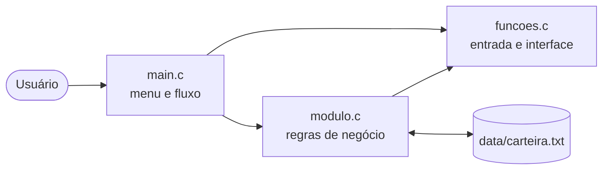

<div align="center">


<br>
<br>


**Aplicação de console para cadastrar, acompanhar e analisar uma carteira de investimentos, com persistência em arquivo texto e um simulador educativo de renda fixa.**

[Sobre](#sobre) •
[Funcionalidades](#funcionalidades) •
[Como executar](#como-executar) •
[Arquitetura](#arquitetura) •
[Persistência](#persistência-de-dados) •
[Cálculos](#regras-de-cálculo) •
[Roadmap](#roadmap) •
[Licença](#licença)

</div>

---

## Sobre

A **Carteira de Investimentos** é um projeto acadêmico (checkpoint) desenvolvido em **linguagem C** que permite registrar ativos financeiros — ações, títulos de renda fixa, fundos etc. — e acompanhar seu desempenho: valor de mercado, rentabilidade individual, rentabilidade geral ponderada e classificação de risco.

O projeto exercita conceitos fundamentais de programação estruturada:

- `struct` e **vetor de structs** para modelar os ativos;
- **modularização** em arquivos `.c` / `.h` com responsabilidades separadas;
- **passagem por referência** com ponteiros;
- **leitura e gravação de arquivos** texto (`fopen`, `fscanf`, `fprintf`);
- **validação robusta de entrada** do usuário;
- **ordenação** com algoritmo *Quicksort* implementado manualmente.

### Impacto social — ODS 8.10

O módulo de simulação apresenta alternativas de investimento (Poupança, Tesouro Selic e CDB) em linguagem simples, ajudando a compreender **rentabilidade, risco e liquidez**. A proposta se alinha à meta **8.10 dos Objetivos de Desenvolvimento Sustentável da ONU**, que incentiva a ampliação do acesso a serviços financeiros para todas as pessoas.

---

## Funcionalidades

| Opção | Funcionalidade | Descrição |
|:-----:|----------------|-----------|
| `1` | **Cadastrar ativo** | Registra nome, categoria, quantidade, preço de compra e preço atual. Salva automaticamente. |
| `2` | **Listar ativos** | Exibe cada posição com valor atual, rentabilidade e classificação de risco, além dos totais da carteira. |
| `3` | **Valor total da carteira** | Soma o valor de mercado de todas as posições. |
| `4` | **Rentabilidade geral** | Calcula a rentabilidade consolidada, ponderada pelo capital investido. |
| `5` | **Ordenar por rentabilidade** ¹ | Ordena a carteira (Quicksort, decrescente) e persiste a nova ordem. |
| `6` | **Simulador educativo** ¹ | Projeta o valor da carteira em 12 meses na Poupança, Tesouro Selic e CDB. |
| `7` | **Relatório final** ¹ | Ranking por rentabilidade, valor total, rentabilidade geral e lucro/prejuízo. |
| `0` | **Salvar e sair** | Grava a carteira em disco e encerra o programa. |

> ¹ As opções 5, 6 e 7 já estão implementadas em `modulo.c` e tratadas no `switch` de `main.c`, mas ainda **não aparecem no menu** e são bloqueadas por `lerOpcao()` (que aceita apenas `0` a `4`). Veja o [Roadmap](#roadmap).

### Validações de entrada

- Campos de texto não podem ficar vazios nem exceder o tamanho máximo (nome: 99, categoria: 49 caracteres).
- O caractere `;` é proibido nos textos, pois é o separador do arquivo de dados.
- Quantidade: inteiro entre `1` e `2.147.483.647`.
- Preço de compra: número **maior que zero**. Preço atual: número **maior ou igual a zero**.
- Entradas com lixo após o número (ex.: `10abc`) são rejeitadas e solicitadas novamente.
- Limite de **100 ativos** por carteira.

---

## Como executar

### Pré-requisitos

- Compilador C compatível com **C99** — [GCC](https://gcc.gnu.org/) no Linux/macOS ou [MinGW](https://www.mingw-w64.org/) no Windows;
- *Opcional:* [Dev-C++](https://sourceforge.net/projects/orwelldevcpp/) 5.11+ para abrir o projeto pela IDE.

### 1. Clonar o repositório

```bash
git clone https://github.com/paulo-henrique-alves-de-almeida/carteira_de_investimentos.git
cd carteira_de_investimentos
```

### 2. Compilar

**Linux / macOS (GCC)**

```bash
gcc -Wall -Wextra -std=c99 -Iinclude src/main.c src/funcoes.c src/modulo.c -o programa -lm
```

**Windows (MinGW, pelo terminal)**

```bash
gcc -Wall -Wextra -std=c99 -Iinclude src/main.c src/funcoes.c src/modulo.c -o programa.exe
```

**Windows (Dev-C++)**

Abra o arquivo `carteira_de_investimentos.dev` e use **Executar → Compilar & Executar** (`F11`). O `Makefile.win` é gerado automaticamente pela IDE.

### 3. Executar

```bash
./programa        # Linux / macOS
programa.exe      # Windows
```

> [!IMPORTANT]
> **Execute a partir da raiz do projeto.** O programa usa o caminho relativo `data/carteira.txt`; a pasta `data/` precisa existir no diretório de trabalho.

### Exemplo de uso

```text
===============================================================
================ CARTEIRA DE INVESTIMENTOS ====================
===============================================================

[1] Cadastrar ativo
[2] Listar ativos
[3] Valor total da carteira
[4] Rentabilidade geral
[0] Salvar e sair

Opção: 1

========== Cadastro de ativo ==========

Nome: PETR4
Categoria: Ação
Quantidade: 100
Preço de compra por unidade: 28.00
Preço atual por unidade: 31.50
Carteira salva em data/carteira.txt.
Ativo cadastrado com sucesso!
```

---

## Arquitetura

```text
carteira_de_investimentos/
├── assets/
│   └── banner.jpg                # Imagem de capa do README
├── include/
│   ├── funcoes.h                 # Protótipos de entrada, validação e interface
│   └── modulo.h                  # Struct Ativo, constantes e protótipos da carteira
├── src/
│   ├── main.c                    # Ponto de entrada: menu e fluxo principal
│   ├── funcoes.c                 # Leitura validada, menu, limpeza de tela, pausa
│   └── modulo.c                  # Regras de negócio, cálculos, ordenação e persistência
├── data/
│   └── carteira.txt              # Base de dados (texto, separado por ";")
├── carteira_de_investimentos.dev # Projeto do Dev-C++
├── Makefile.win                  # Makefile gerado pelo Dev-C++
├── carteira_de_investimentos_v1.zip  # Histórico: versão 1
├── carteira_de_investimentos_v2.zip  # Histórico: versão 2
└── LICENSE
```

### Camadas



### Modelo de dados

```c
typedef struct {
    char   nome[TAM_NOME];            // 100
    char   categoria[TAM_CATEGORIA];  // 50
    int    quantidade;
    double precoCompra;
    double precoAtual;
} Ativo;
```

### Principais constantes (`include/modulo.h`)

| Constante | Valor | Uso |
|-----------|-------|-----|
| `MAX_ATIVOS` | `100` | Capacidade máxima da carteira |
| `ARQUIVO_CARTEIRA` | `"data/carteira.txt"` | Caminho do arquivo de dados |
| `MESES_SIMULACAO` | `12` | Horizonte do simulador |
| `TAXA_POUPANCA` | `0.0050` | 0,50% a.m. (ilustrativa) |
| `TAXA_TESOURO_SELIC` | `0.0080` | 0,80% a.m. (ilustrativa) |
| `TAXA_CDB` | `0.0090` | 0,90% a.m. (ilustrativa) |

---

## Persistência de dados

Os ativos são gravados em `data/carteira.txt`, **um ativo por linha**, com campos separados por ponto e vírgula:

```text
nome;categoria;quantidade;precoCompra;precoAtual
```

Exemplo:

```text
PETR4;Ação;100;28,00;31,50
TESOURO SELIC;Renda Fixa;10;10600,00;10850,00
```

**Comportamento:**

- **Carregamento** — ao iniciar. Se o arquivo não existir, a carteira começa vazia e o arquivo é criado no primeiro salvamento.
- **Gravação** — após cada cadastro, após ordenar/gerar relatório e ao sair (opção `0`).
- **Registros inválidos** (quantidade negativa, preço de compra ≤ 0 ou preço atual < 0) são ignorados na leitura, com aviso.

> [!NOTE]
> **Separador decimal:** o programa chama `setlocale(LC_ALL, "")`, então `fscanf`/`fprintf` seguem a localidade do sistema. Em ambientes pt-BR, os valores são gravados com **vírgula** (`28,00`); em outras localidades, com **ponto**. Na digitação pelo teclado, use o separador da sua localidade (a mensagem do programa sugere ponto).

---

## Regras de cálculo

| Métrica | Fórmula |
|---------|---------|
| Valor atual da posição | `quantidade × precoAtual` |
| Rentabilidade do ativo | `(precoAtual − precoCompra) ÷ precoCompra × 100` |
| Valor total da carteira | `Σ (quantidade × precoAtual)` |
| Rentabilidade geral | `(valorAtualTotal − custoTotal) ÷ custoTotal × 100` |
| Lucro / prejuízo | `valorAtualTotal − custoTotal` |
| Simulação (juros compostos) | `valorInicial × (1 + taxaMensal)^12` |

A rentabilidade geral é **ponderada pelo capital investido**: ativos com maior custo de aquisição pesam mais no resultado.

### Classificação de risco

Atribuída a cada ativo com base na sua rentabilidade:

| Rentabilidade | Classificação |
|---------------|:-------------:|
| abaixo de −10% | **Alto** |
| de −10% até 0% (exclusive) | **Atenção** |
| exatamente 0% | **Neutro** |
| acima de 0% | **Positivo** |

### Ordenação

A carteira é ordenada por rentabilidade **decrescente** com um **Quicksort** recursivo (pivô central, partição de Hoare), implementado em `modulo.c` — complexidade média `O(n log n)`.

> [!WARNING]
> as taxas do simulador são **fixas e ilustrativas**. Não refletem as taxas vigentes de mercado e **não constituem recomendação de investimento**.

---

## Roadmap

- [ ] Exibir as opções `5`, `6` e `7` no menu e ampliar o intervalo aceito por `lerOpcao()` para `0–7`.
- [ ] Padronizar a codificação dos fontes em **UTF-8** (alguns arquivos estão em Latin-1/Windows-1252, o que gera caracteres corrompidos em terminais UTF-8).
- [ ] Tornar o arquivo de dados independente da localidade (sempre ponto decimal).
- [ ] Editar e remover ativos já cadastrados.
- [ ] Permitir configurar as taxas do simulador.
- [ ] Criar `Makefile` multiplataforma.
- [ ] Adicionar testes automatizados para as funções de cálculo.

---

## Contribuindo

1. Faça um *fork* do projeto.
2. Crie uma branch: `git checkout -b feature/minha-melhoria`.
3. Faça *commit* das alterações: `git commit -m "feat: descreve a melhoria"`.
4. Envie para o seu fork: `git push origin feature/minha-melhoria`.
5. Abra um *Pull Request*.

Mantenha o padrão do código: nomes em português, *camelCase* e compilação sem *warnings* com `-Wall -Wextra`.

---

## Autor

**Paulo Henrique Alves de Almeida**

[](https://github.com/paulo-henrique-alves-de-almeida)

---

## Licença

Distribuído sob a licença **MIT**. Consulte o arquivo [`LICENSE`](LICENSE) para mais detalhes.
